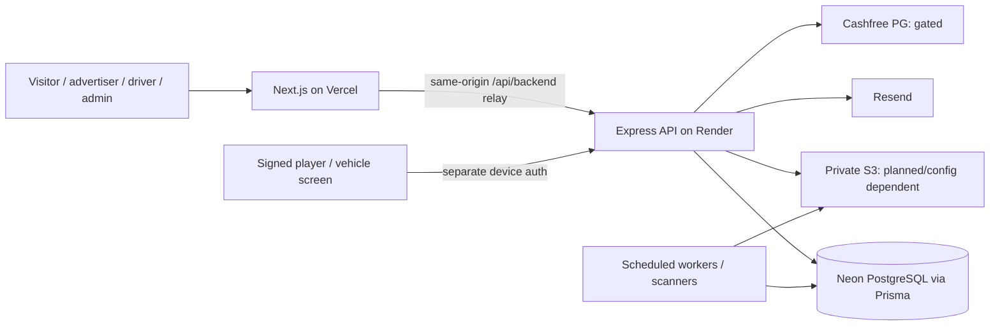

# 01 — System architecture

## Product and deployment topology

BlinkMyAd is a modular monolith for advertising on mobile digital screens. A Next.js 16 frontend exposes public marketing pages and three authenticated portals; an Express 5/TypeScript backend is the only authority for business rules, sessions and state transitions. PostgreSQL/Prisma holds users, organizations, physical inventory, campaigns, evidence, finance and audit records.

## Runtime boundaries

1. The browser sends session-bound requests to `/api/backend/*` on Next.js, which relays only allowlisted paths and methods to Express `/api/v1/*`. `ADVIBE_BACKEND_ORIGIN` is server-side, not public.
2. Express validates input with Zod, resolves server sessions and role, enforces ownership and CSRF where applicable, applies transactional mutations, then returns sanitized JSON.
3. The database is transactional and authoritative. A UI success indicator never proves payment settlement, device playback or driver payout.
4. Device requests use separate signed identity, timestamps and nonce replay protection. Browser session cookies must not authenticate hardware.
5. Scheduled workers run outside the HTTP process. Queuing a job does not execute it until the proper worker is deployed.
6. External provider adapters must independently reconcile irreversible outcomes. Development mocks are disallowed in production.

## Module boundaries

| Domain | Source | Primary responsibility |
| --- | --- | --- |
| Identity | `backend/src/modules/auth` | Signup, verification, sessions, Admin MFA, CSRF policy |
| Accounts | `accounts`, `businesses` | Profile, advertiser business and membership |
| Driver compliance | `drivers`, `kyc` | Driver applications, vehicle and documents |
| Physical inventory | `geo`, `devices` | City/zone/location, screen placement, pairing |
| Content | `creatives`, `campaigns` | Media, approval and campaign revisions |
| Commercial | `pricing`, `reservations`, `payments`, `finance` | Quotes, holds, payment and tax |
| Delivery | `delivery`, `devices/player`, `telemetry` | Schedule, manifest, evidence and GPS |
| Earnings | `earnings` | Reviewed ledger, settlements and transfers |
| Operations | `support`, `admin` | Tickets, notifications, reports and audit |

## Deployment readiness

Repo code, unit/integration tests and a staging Render blueprint exist. Running production requests requires verified HTTPS domains, a migrated Neon instance, real login, Admin MFA, worker deployment, private storage, provider sandboxes, release gates and independent legal/security/operations signoff. `render.yaml` is staging-focused and disables money, device and creative-worker functionality.

## Architectural decisions

- Keep one relational database and a modular backend until measured scaling needs justify a split.
- Never substitute fictional front-end demo data for failed backend API requests.
- All money is represented in integer INR paise; do not trust frontend supplied totals.
- Enforce geographically restricted live launch at the backend, currently limited to Prayagraj.
- Use immutable audit/ledger records for evidence; edits and destructive restores need formal approval.
