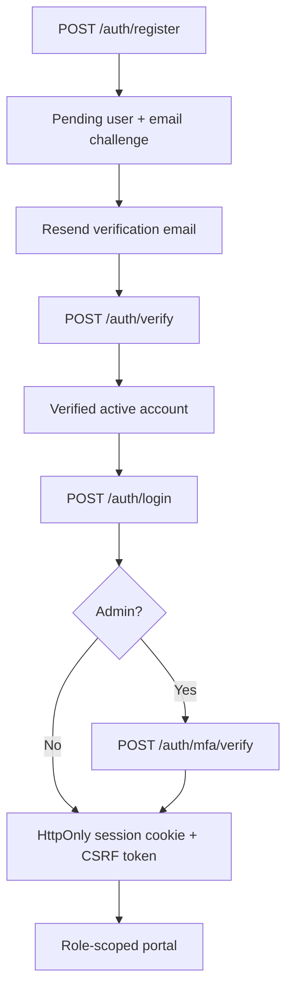

# 02 — Identity, sessions and authorization

## User roles

- `ADVERTISER`: owns/manages business records, creatives and campaigns; can view only authorized business data.
- `DRIVER`: controls own application/vehicles/consent and views own earnings and support.
- `ADMIN`: reviews catalog, KYC, creatives, business decisions, pricing, settlement and audit; requires completed MFA.

Roles are enforced by Express using `resolvePrincipal`, `requireRole`, and business membership checks, never a frontend role picker. No public Admin signup.

## Registration and password recovery

Use `POST /auth/forgot-password` to request a one-use reset token and `POST /auth/reset-password` to rotate credentials. Password reset invalidates previous sessions. `POST /auth/logout` and `/auth/logout-all` revoke sessions. The registration route rate-limits and prevents role escalation.

## Session and request behavior

- Argon2id password hashes, server-held session token hashes and HTTP-only cookies; no bearer credentials in `localStorage`.
- Mutating cookie-session requests require an exact allowed origin and valid `X-CSRF-Token`, except the special registration/recovery entrypoints that have separate protections.
- Admin needs an enrolled authenticator and verified session step, not merely an `ADMIN` database role.
- Browser relayed paths are constrained by `src/services/api-route-policy.mjs`; device/webhook routes must not pass through the browser relay.
- Requests should use `Idempotency-Key` when the API requires it, and must be retried with the same key only for the same request.

## Test evidence

Domain tests: `auth.integration.test.ts`, `security.integration.test.ts`, `accounts.integration.test.ts`. Cross-module anonymous and role-scoped GET coverage: `api-boundaries.integration.test.mjs`. Live Resend delivery and cross-domain cookie behavior must still be validated on HTTPS staging.
