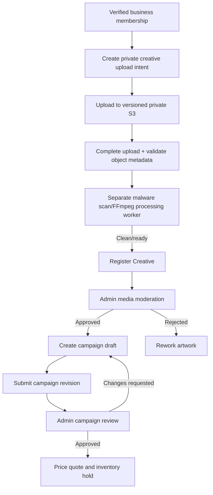

# 03 — Advertiser account to active campaign

## Business lifecycle

1. Advertiser registers, verifies email and signs in.
2. Creates a business at `POST /businesses`; the backend creates ownership/membership and an audit event transactionally.
3. Owner or manager maintains account and business profile; membership is verified on every protected resource access.
4. Public screen formats and published locations can be browsed, but catalog visibility alone does not prove bookable hardware.

## Creative and review lifecycle

Creative uploads require private S3 and a deployed malware/media worker. These provider steps are **not tested or enabled** in the current external-service-excluded pass.

## Campaign transitions

- `POST /campaigns` creates a draft bound to a business and processed creative.
- `PATCH /campaigns/:campaignId` revises an editable draft; optimistic version/state rules apply.
- `POST /campaigns/:campaignId/submit` snapshots the submitted revision and applies eligibility checks.
- `POST /admin/campaigns/:campaignId/decision` records a reviewed decision; the reviewer must be authorized.
- Approved creative + approved campaign does **not** automatically imply a purchased booking or an active screen playlist.

## Completion checks

Record a successful controlled end-to-end advertiser scenario with two separate businesses: unaffiliated users must not access each other's drafts, quotes, creative assets or payment records; stale revisions and repeated idempotency keys must not create duplicates.

Tests: `accounts.integration.test.ts`, `creatives.integration.test.ts`, `campaigns.integration.test.ts`, `pricing.integration.test.ts`, `reservations.integration.test.ts`.
