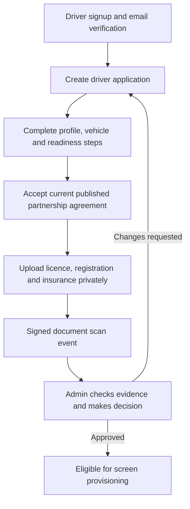

# 04 — Driver onboarding, vehicles, KYC and approval

## Driver journey

Drivers use `GET/POST /drivers/applications`, `PATCH /drivers/applications/:id`, and `POST /drivers/applications/:id/submit`. Vehicle records are under `/drivers/me/vehicles`. Admin review endpoints reside under `/admin/driver-applications` and `/admin/driver-documents`.

## Compliance boundaries

- Driver applications must have the correct current agreement version and legally reviewed policy before final submission.
- Documents use private, encrypted, versioned S3 buckets with short signed uploads, validation and a signed scan webhook. A document upload is not identity verification.
- Driver ownership, document state and independent Admin review gate the next step.
- The backend must not collect or expose raw identity documents through the frontend API relay or analytics.
- Retention is controlled by `KYC_RETENTION_DAYS`, `KYC_SCAN_SECRET` and approved agreement/privacy versions.
- No production KYC provider or secure object storage is established by the source tests.

## Test focus

`drivers.integration.test.ts` exercises application and ownership transitions; `kyc.integration.test.ts` tests the storage policy and state machine with injected test doubles. Live file uploads, scanner infrastructure and legal approval remain separate launch gates.
