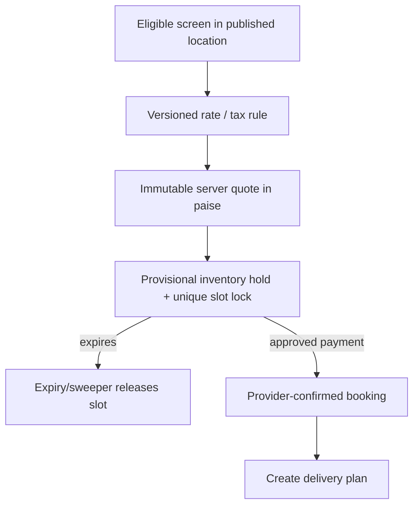

# 05 — Geography, screens, pricing, reservations

## Inventory model

`City → Zone → Location → Screen → Vehicle/Driver`. Admin publishes cities, zones and locations and binds approved screens to a location. The public catalog returns only published entries. Production catalog queries are constrained to Prayagraj. Coordinates are stored in PostgreSQL; radius/bounding-box queries are calculated server-side.

Google Maps, Places, geocoding and route APIs are **not integrated** in the inspected backend. They are deliberately excluded from the current test scope, and a Google API key alone will not implement them.

## Commercial booking flow

`GET /public/locations`, `/public/zones`, `/public/cities`, and `/inventory/screens` support discovery. `POST /pricing/quotes` computes a quote from server-side pricing rules; `POST /reservations/holds` creates an exclusive time-limited hold. Concurrency enforcement uses transactionally locked screen/day inventory. An expired hold cannot become active merely because a payment provider returns success later.

## Essential invariants

- Displayed inventory and published location data are **not** claims about real installed devices or available capacity.
- Quote amounts are immutable snapshots, not values accepted from a checkout form.
- Active holds use unique inventory slots and idempotency; timeouts are cleared by a separate sweeper.
- Production flags `BOOKING_HOLDS_ENABLED` and approved tax policy are intentionally off until financial/hardware checks are complete.

Tests: `geo.integration.test.ts`, `devices.integration.test.ts`, `pricing.integration.test.ts`, `reservations.integration.test.ts`.
