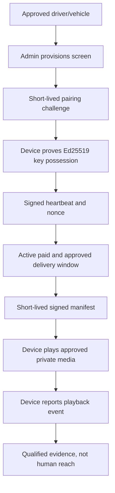

# 06 — Screens, hardware, scheduling and telemetry

## Roles and components

A driver vehicle may have a provisioned screen; an administrator confirms the driver/vehicle and approved installation. Hardware identities are separate from browser sessions. Screen signing keys and device-authenticated data are required for trusted operations.

## Provisioning and runtime flow

## Security properties

- `POST /devices/pair` binds a verified public key to an approved screen. Device requests use `X-Device-ID`, `X-Device-Timestamp`, `X-Device-Nonce`, and `X-Device-Signature`.
- Nonce uniqueness, timestamp windows, revocation and signed manifests defend against replay and unauthorized devices.
- Playback issuance needs an approved campaign, confirmed inventory entitlement, active delivery plan and scanned approved private creative. If that evidence fails, the player returns a signed STOP manifest where appropriate.
- A heartbeat is device telemetry, not proof that a human saw an advertisement.
- A playback report is device-reported evidence, not independently verified impressions.

## Consent and GPS

Driver accepts a purpose-specific GPS policy before starting a trip. `/devices/trip-events` stores bounded, plausibility-checked coordinates only for an active consented trip. `/devices/playback-events` ties device evidence to the trip/manifest. Revocation and expiry stop collection; `gps:purge` runs on a separate scheduled worker. Apply D09 privacy review and data minimization prior to enabling real collection.

## Workers and permissions

Delivery state transitions are reconciled by `npm --prefix backend run delivery:tick` on an external scheduler. Device pairing, device calls and GPS are not proxied through the public browser relay. Production gates include `DEVICE_PLAYBACK_ENABLED`, `DEVICE_FLEET_APPROVED`, manifest Ed25519 signing and reviewed GPS policies.

Tests: `devices.integration.test.ts`, `player.integration.test.ts`, `delivery.integration.test.ts`, `telemetry.integration.test.ts`. Real firmware, vehicle installation and field acceptance have not been verified.
