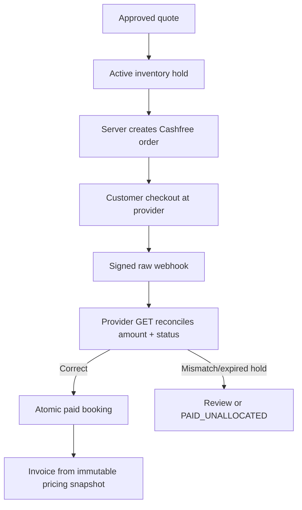
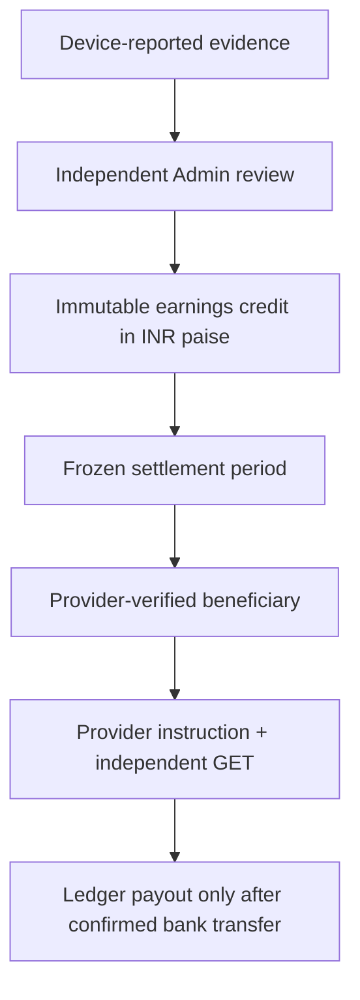

# 07 — Payments, invoices, earnings and payouts

## Advertiser charge to confirmed booking

An advertiser browser redirect is never settlement proof. Cashfree webhook signatures, order IDs, amounts and status are verified server-side; repeated notifications are idempotent. The current source contains the Cashfree PG client and refund API client, but real sandbox/production provider connectivity is intentionally outside the current test pass.

## Tax and refunds

Tax policy and invoice issuance require real issuer metadata, accurate place of supply, approved GST/tax basis and finance signoff. `/admin/invoices` snapshots tax figures; `/admin/refunds` and `/admin/finance/reconcile/:orderId` must independently check provider status. Statutory electronic invoice IRN and tax filing are **not** implemented by the backend.

## Driver compensation

Driver ledger entries are not calculated directly from estimated impressions. The current default `configuredPayoutGateway()` deliberately returns HTTP 503; the real payout adapter is not implemented. No driver bank-transfer capability should be claimed until the adapter and real provider reconciliation are complete.

## Source / tests

`payments`, `finance`, `earnings` source directories. Domain tests include `payments.integration.test.ts`, `finance.integration.test.ts`, `earnings.integration.test.ts`. Existing tests use injected fake gateways for reproducible accounting logic; the new cross-module suite skips real provider operations. `PAYMENTS_ENABLED`, `BOOKING_HOLDS_ENABLED`, `B18_PAYOUTS_ENABLED`, `B19_REFUNDS_ENABLED`, `B19_TAX_INVOICES_ENABLED`, and approved tax/finance policy stay off without verified approvals.
