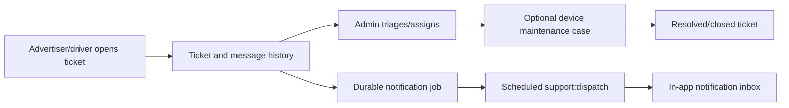

# 08 — Administration, support and notifications

## Administration

Admin-only handlers cover publication of cities/zones/locations and pricing rules, review of driver applications and creative/campaign submissions, user suspension/reactivation, bounded financial reports, audit history and exports.

- Every privileged session must complete Admin MFA.
- Account status changes require audit reason and expected prior status.
- CSV report exports are scoped, bounded and sanitized for spreadsheet formula injection; export itself is audited.
- Admin status does not confer automatic advertiser membership in private business data.

## Support lifecycle

Routes under `/support/tickets`, `/admin/support/tickets`, `/maintenance` and `/notifications` are backed by PostgreSQL. The queue leases jobs with `FOR UPDATE SKIP LOCKED`, retries and records dead-letter state. `npm --prefix backend run support:dispatch` is a separately deployed worker; without it users may have ticket records but no delivered notifications.

Email/SMS/push dispatch of support notices is not automatically supplied by Resend. Current support jobs write in-app notifications only. Do not imply customers receive WhatsApp or SMS alerts unless an authorized provider dispatcher exists.

## Verification

`support.integration.test.ts` tests ticket visibility, ownership, transitions, job leasing, deduplication and notification acknowledgment. `admin.integration.test.ts` tests reports, RBAC, suspension and audit behavior. Cross-module anonymous GET and mutation boundaries run through `api-boundaries.integration.test.mjs`.
